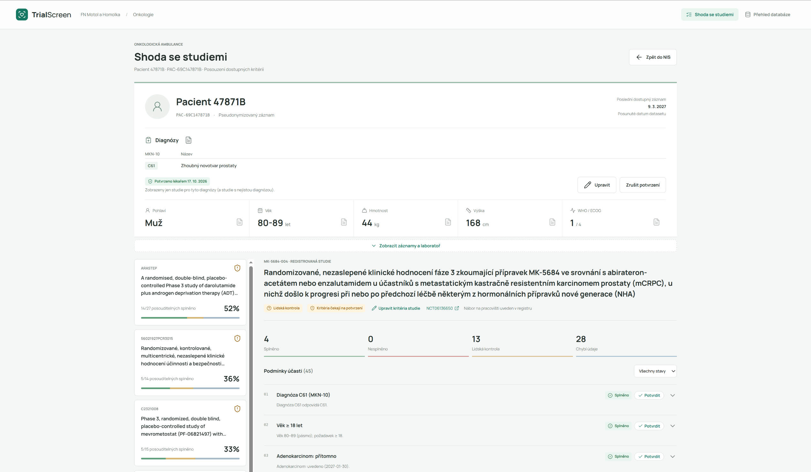

# TrialScreen

**Žádný vhodný pacient by neměl přijít o klinickou studii jen proto, že ji nikdo nestihl dohledat.**

TrialScreen je platforma týmu **Smradi** z Rakathonu 2026. Jde o doplněk ke stávajícímu nemocničnímu
informačnímu systému (NIS). Lékaři nenápadně ukáže, že jeho pacient může odpovídat některé z klinických studií,
které na pracovišti probíhají. Ke každé studii vidí, která kritéria pacient splňuje, která ne a co chybí doplnit.
V přehledu může procházet všechny studie a pacienty a podívat se, jak moc k sobě sedí.



## Jak to funguje

1. **Studie.** Kritéria účasti stahujeme z registru ClinicalTrials.gov a jazykový model je převede do
   strukturované podoby (např. „věk alespoň 18 let“, „ECOG 0–1“).
2. **Pacienti.** Z dokumentace v NISu (zprávy, laboratoř, léčba) lokální jazykový model vytáhne údaje
   důležité pro studie. U každého údaje si ukládáme přesnou citaci ze zprávy, ze které pochází.
3. **Porovnání.** Údaje pacienta porovnáme s kritérii studie a spočítáme, kolik jich sedí. Výsledek se
   lékaři ukáže jako zelené upozornění na kartě pacienta a v detailu u každého kritéria vidí zvýrazněný
   doklad ve zprávě.

Všechno ukládáme do vlastní lokální databáze. Lékař v ní může vyčtené údaje opravit a potvrdit.

## Čím se lišíme

- **On-premise.** Data pacientů zpracovává lokální model a zůstávají v nemocnici. Ven jdou jen dotazy na
  veřejný registr studií.
- **Rozhoduje lékař.** Systém jen upozorňuje. Lékař vyčtené údaje potvrzuje a o zařazení do studie
  rozhoduje on, takže zodpovědnost zůstává u něj. Jeho opravy se ukládají vedle původních dat, nic se
  nepřepisuje.
- **Nikoho nevyřadíme kvůli chybějícímu údaji.** Pacienta ze studie nevylučujeme, dokud nemáme doložený
  vylučovací údaj. Chybějící informace se ukáže jako „chybí údaje“ s návrhem, co doplnit.
- **Každé tvrzení má doklad.** Citace ověřujeme v kódu a logiku kritérií počítáme deterministicky, ne
  jazykovým modelem. Tvrzení bez dokladu jde vždy k lidské kontrole.
- **Snadná integrace.** Čteme standardní FHIR export z NISu a do jeho rozhraní přidáváme jen malý widget
  na kartu pacienta. Zbytek běží v samostatném okně.

## Úspornost a plány

Už teď šetříme volání modelu: každý krok zpracování si pamatujeme podle otisku vstupu, takže se model
volá znovu jen při změně dokumentace nebo studie. Do porovnání posíláme jen vyčtené údaje, ne celé zprávy.

Do budoucna plánujeme:

- **RAG.** Ke každému kritériu vyhledat jen relevantní pasáže dokumentace místo zpracování celé historie
  pacienta. Bude to rychlejší, levnější a zvládne to i velmi dlouhou dokumentaci.
- **LLM judge.** Druhý model nezávisle zkontroluje každý závěr proti citaci a neshody pošle lékaři.
- **Hlubší napojení na NIS.** Seznam „moji pacienti“, upozornění jen při změně (nová zpráva, nová studie)
  a zápis potvrzených údajů zpět do NISu.

## Spuštění

Potřebujete [uv](https://docs.astral.sh/uv/), do kořene repozitáře vložit složku s daty pacientů
(`rakathon-dataset-*/`) a seznam studií (`*.xlsx`). Ty do Gitu nepatří a nejsou v něm.

```sh
uv sync
scripts/run_trialmatch.sh        # pravidlový engine, vše lokálně; první běh předpočítá pacienty (pár minut)
```

Aplikace běží na http://127.0.0.1:8765. Úvodní stránka simuluje NIS, widget „studie k posouzení“ otevře
TrialScreen. Volitelně lze zapnout i lokální jazykový model (`--download-model`, pak `--llm`). Podrobnosti,
varianta s modelem v cloudu a popis enginu jsou v [docs/TECHNICAL.md](docs/TECHNICAL.md).
